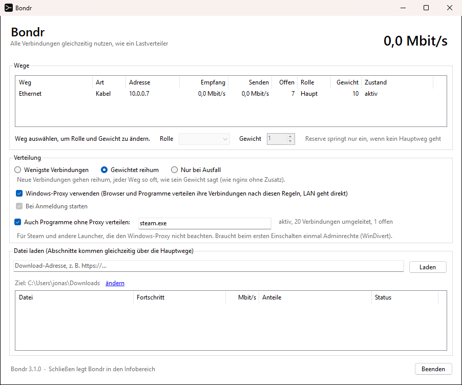

<p align="center"></p>
<h1 align="center">Bondr</h1>
<p align="center">Alle Internetzugänge eines Rechners gleichzeitig.</p>

| | Windows 10/11 | macOS 14+ | Linux | Android 10+ |
|---|---|---|---|---|
| Lastverteiler mit Gewicht, Reserve und Gesundheitsprüfung | ja | ja | ja | ja |
| Programme, die den Systemproxy beachten | ja | ja | GNOME, KDE | alle Apps (VPN) |
| Programme ohne Proxy, etwa Steam | ja | nein | nein | ja |
| Downloads über mehrere Wege zugleich | ja | ja | ja | ja |
| Datenverbrauch je Weg (Monat, gesamt) | ja | ja | ja | ja |

Bondr nutzt alle Internetzugänge eines Rechners gleichzeitig, wie ein Lastverteiler: Kabel, WLAN, Handy per USB oder ein zweiter Router. Für Windows 10/11, macOS 14+ (Apple Silicon wie M4 und Intel) und Linux (x86_64 und ARM64).

<p align="center"></p>

## Wie ein nginx-Upstream

Jeder Weg hat ein **Gewicht** (1 bis 10) und eine **Rolle**:

| Rolle | Bedeutung | nginx |
|---|---|---|
| Haupt | bekommt Verbindungen nach Gewicht | `server … weight=n` |
| Reserve | nur, wenn kein Hauptweg geht | `backup` |
| Aus | nie | `down` |

Vorgabe: Kabel Gewicht 10, WLAN 7, Handy (USB-Tethering) 3, alle als Hauptweg. Die eigene Verbindung zum Router wird also bevorzugt, das Handy läuft mit.

**Strategien** für neue Verbindungen:

- **Wenigste Verbindungen** (Vorgabe): an den Weg mit den wenigsten offenen Verbindungen im Verhältnis zum Gewicht (`least_conn`).
- **Gewichtet reihum**: reihum, jeder Weg so oft wie sein Gewicht (nginx-Standard, „smooth weighted round robin“).
- **Nur bei Ausfall**: alles über den stärksten Hauptweg, die anderen springen nur bei Ausfall ein.

Alle 15 Sekunden prüft Bondr jeden Weg mit einer Probeverbindung (`health_check`); ein Weg, der nicht durchkommt, bekommt keine neuen Verbindungen, bis er wieder geht.

## Was verteilt wird

**Programme über den Systemproxy.** Bondr ist ein lokaler Proxy (SOCKS5 und HTTP auf `127.0.0.1:1080`). Mit „Windows-Proxy“ bzw. „Systemproxy“ benutzen ihn Browser und alle Programme, die den Systemproxy beachten. Eine einzelne Verbindung läuft immer über einen Weg; viele gleichzeitige verteilen sich. Adressen im LAN gehen direkt. Solange der Proxy an ist, startet Bondr bei der Anmeldung mit, sonst hätte der Browser nach einem Neustart kein Internet.

**Programme ohne Proxy (nur Windows).** Steam und manche andere Launcher laden am Windows-Proxy vorbei. Mit „Auch Programme ohne Proxy verteilen“ fängt Bondr die Verbindungen der eingetragenen Programme (Vorgabe `steam.exe`) mit [WinDivert](https://github.com/basil00/WinDivert) ab und gibt sie über den eigenen Proxy weiter, so verteilen sich auch deren viele gleichzeitige Downloads auf alle Hauptwege. Das braucht Adminrechte: beim ersten Einschalten fragt Windows einmal, Bondr legt dabei die geplante Aufgabe „Bondr Umleitung“ an und startet den Umleiter danach ohne Rückfrage. Er endet, sobald die Umleitung aus ist oder Bondr beendet wird. Nur IPv4, nur Ziele im Internet.

**Downloads.** Eine Datei kommt in Abschnitten gleichzeitig über die Hauptwege, je Weg so viele Verbindungen, wie das Gewicht hergibt; freie Verbindungen übernehmen die hintere Hälfte des größten offenen Abschnitts. Hier addiert sich die Bandbreite auch für eine einzelne Datei.

Echtes Bündeln einer einzelnen Verbindung braucht einen Server auf der anderen Seite (MPTCP, Speedify); das macht Bondr nicht.

## Installieren

- **Windows:** `Bondr-<Fassung>-Setup.exe` aus den Releases. Installiert für den angemeldeten Benutzer (ohne Adminrechte) nach `%LOCALAPPDATA%\Programs\Bondr`, mit Startmenü-Eintrag und Deinstallation über „Apps“.
- **macOS:** `Bondr-<Fassung>-mac.dmg` öffnen und Bondr in „Programme“ ziehen. Bondr sitzt in der Menüleiste. Die App ist nur ad-hoc signiert: beim ersten Start Rechtsklick, „Öffnen“.
- **Android:** `Bondr-<Fassung>-android.apk` installieren (Android 10 oder neuer, ARM64). Beim ersten Start fragt Android einmal, ob Bondr ein VPN einrichten darf. Bondr hält WLAN und Mobilfunk gleichzeitig offen und verteilt den Verkehr aller Apps über ein VPN auf dem Gerät, es geht nichts über fremde Server. Mobilfunk nur mit IPv6 (etwa Telekom mit 464XLAT) wird unterstützt. Ein- und Ausschalten geht auch über die Schnelleinstellungen.
- **Linux:** Debian/Ubuntu `sudo apt install ./bondr_<Fassung>_amd64.deb`, Fedora/openSUSE `sudo dnf install ./bondr-<Fassung>-1.x86_64.rpm`. Sonst `Bondr-<Fassung>-linux-<arch>.tar.gz` entpacken und `./installieren.sh` (für den Benutzer, ohne root; braucht Python 3 mit PyGObject, GTK 4 und libadwaita 1.2+). Das Fenster schließen lässt Bondr weiterlaufen, „Beenden“ steht im Menü. Der Systemproxy wird in GNOME (auch Cinnamon, Budgie) und KDE gesetzt; Firefox und Chrome folgen ihm.

## Aufbau

| Teil | Ordner | Sprache |
|---|---|---|
| Kern `bondrd`: Lastverteiler, Proxy, Downloader, Steuerung auf 127.0.0.1:47801 | `cmd/`, `internal/` | Go |
| Windows-App mit Infobereich, Installer | `windows/` | C# (WinForms, .NET Framework 4.8), NSIS |
| Mac-App in der Menüleiste | `mac/` | Swift (SwiftUI) |
| Linux-App, Pakete .deb/.rpm | `linux/` | Python (GTK 4, libadwaita), nfpm |
| Android-App mit VPN-Tunnel | `android/`, `internal/tunnel` | Kotlin (Compose), Go mit gVisor-Netzwerkstapel |

Die Apps starten den Kern und steuern ihn; die Steuerung verlangt einen Schlüssel aus einer nur für den Benutzer lesbaren Datei. Jede ausgehende Verbindung wird an ihren Adapter gebunden (`IP_UNICAST_IF` unter Windows, `IP_BOUND_IF` unter macOS, `SO_BINDTODEVICE` unter Linux, ab Kernel 5.7 ohne root, unter Android über `Network.bindSocket` der App).

Einstellungen: `%APPDATA%\Bondr\einstellungen.json`, `~/Library/Application Support/Bondr/einstellungen.json` bzw. `~/.config/Bondr/einstellungen.json`.

## Bauen

```
go test ./...
# Windows (auf Windows, ohne Visual Studio):
go build -ldflags "-H windowsgui" -o windows/dist/bondrd.exe ./cmd/bondrd
windows\bauen.cmd
makensis windows/installer.nsi
# macOS (mit Xcode):
GOOS=darwin GOARCH=arm64 go build -o mac/kern/bondrd-arm64 ./cmd/bondrd
GOOS=darwin GOARCH=amd64 go build -o mac/kern/bondrd-amd64 ./cmd/bondrd
mac/bauen.sh <Fassung>      # z. B. 3.1.0
# Android (Go-Kern als libbondrd.so, APK im Container oder mit ANDROID_HOME):
android/bauen.sh release
# Linux:
go build -o linux/bondrd ./cmd/bondrd && linux/bondr.py
```

Jeder Push wird geprüft und gebaut, Releases entstehen bei jedem Tag `v*`. Was sich ändert, steht im [CHANGELOG](CHANGELOG.md).

## Lizenz

MIT. Der Windows-Installer enthält WinDivert 2.2.2 (LGPL 3 oder GPL 2, `WinDivert-LIZENZ.txt`).
